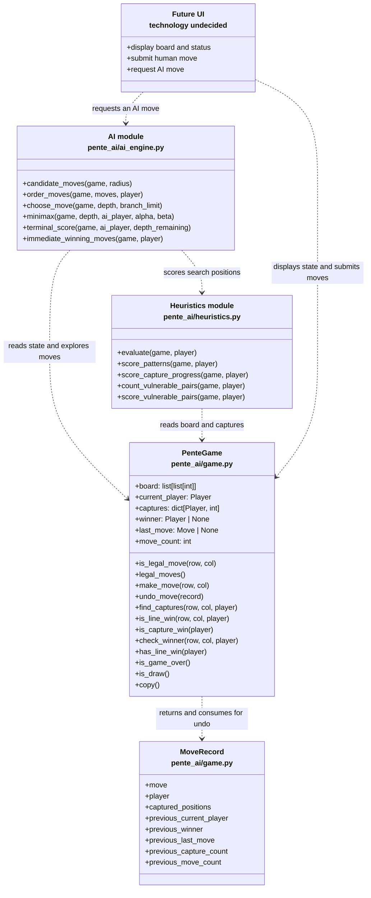

# Pente AI

An intelligent Pente player. The AI uses Minimax, alpha-beta pruning, and heuristic evaluation.

## Planned architecture

```text
             User interface
                   │
                   ▼
             Game interface
           ┌───────┴────────┐
           ▼                ▼
       Game rules         AI search
                              │
                       ┌──────┴──────┐
                       ▼             ▼
                  Move search    Heuristics
```

- **Game rules** own the board, turns, legal move validation, captures, win detection, and reversible moves for search.
- **Move search** generates a reduced set of candidate moves, orders them, and explores them with Minimax and alpha-beta pruning.
- **Heuristics** score non-terminal positions from a selected player's perspective, including line patterns, capture progress, and capture risks.
- **GUI** displays the board and passes user-selected moves to the game rules. It must not duplicate game rules.

### Shared game-state data structure

`PenteGame` in `pente_ai/game.py` is the shared representation of one position. It is a dataclass, so a new game starts with a separate empty 19×19 board and separate capture counters for White and Black. The UI and AI receive the same object; the UI reads it to display the position, while the AI reads it during search and will use the move/undo API to explore future positions.

| Field | Type | Meaning |
|---|---|---|
| `board` | `list[list[int]]` | 19×19 matrix: `0` empty, `1` White, `2` Black |
| `current_player` | `int` | Side whose turn it is (`WHITE` or `BLACK`) |
| `captures` | `dict[int, int]` | Number of opposing stones each player has captured; counts stones, not pairs |
| `winner` | `int \| None` | Winning side, or `None` while play continues |
| `last_move` | `tuple[int, int] \| None` | Most recent `(row, column)`, useful for highlighting and local win checks |
| `move_count` | `int` | Number of moves made, starting at zero |

`MoveRecord` stores the move and the prior values needed to restore the state after AI search. The data structures and default initialization are present; the game-rule and AI methods remain placeholders.

## Planned class and module relationships

The module boxes below group top-level Python functions; they are not proposed Python classes. The UI box is a future component, not a file in the scaffold.



The Python files define these interfaces only. Each function and method currently raises `NotImplementedError`; the rules, search, and scoring logic have not been implemented.

## Rules of the game

These are the rules planned for this project, based on the written assignment. They intentionally use its White-first turn order.

### Board and turn order

- The board is a 19×19 grid of intersections. Stones are placed on intersections, not in the squares.
- Each point is represented as `0 = empty`, `1 = White`, or `2 = Black`.
- White takes the first turn. Players then alternate, placing one stone per turn.
- Stones stay where they are placed unless removed by a capture.

### Legal moves

- A move must be on the board and on an empty intersection.
- A move may be played anywhere on the board; this project does not impose an opening-center or tournament restriction.
- No move may be made after a player has won.

### Capturing stones

Capturing occurs if you place one of your stones on both sides of a pair of your opponents stones. For example, if the stones are like this XOO and you place your stone so it becomes XOOX, then your opponents stones are removed from the board, leaving X__X. Capturing is good to slow your opponent from getting 5 in a row, but you can also win at Pente by capturing. If you capture 10 or more of your opponents stones you win (5 or more captures).

Another thing to realize is you can't play into a capture. If the board position is like this XO_X, and you place your stone such that the board is like XOOX, then your stones are NOT captured.

- Captures can happen horizontally, vertically, or diagonally, in either direction.
- Only pairs are captured. A single enemy stone or three consecutive enemy stones do not match the capture pattern.
- All captures caused by one move are resolved on that move. One move may capture pairs in multiple directions.
- Captured stones are removed from the board. The capturing player's count increases by two for each pair (the count tracks stones, not pairs).
- A player may place a stone between two enemy stones. That move is legal, and the newly placed stone is not captured as a result of that placement.

### Winning and ending the game

A player wins as soon as either condition is met:

1. **Five in a row:** five or more of that player's stones form an unbroken horizontal, vertical, or diagonal line.
2. **Captures:** that player has captured ten or more opposing stones (five pairs).

The win is checked after captures from the move have been resolved. If the board fills with no winner, the game is a draw; the assignment does not specify this rare case.

## Project files

```text
pente_ai/
  __init__.py      # Package entry points
  game.py          # Board state and rules
  heuristics.py    # Position evaluation
  ai_engine.py     # Candidate generation and Minimax/alpha-beta
```
## references

**Live website:** https://www.pente.org/gameServer/mmai/
